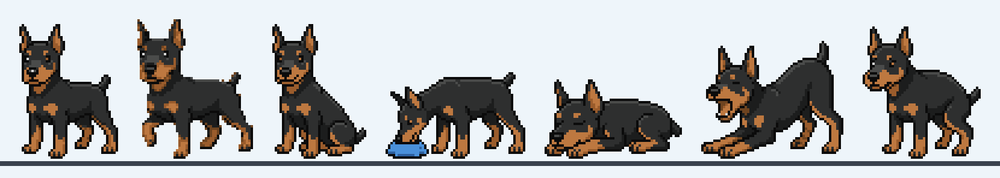

# 🐾 pets — 住在工作列上的小杜賓



**DobyPet** 是一隻住在 Windows 工作列上的像素風小杜賓。牠會在工作列上散步、打盹、伸懶腰、吃飯、便便、放臭屁、偶爾來個後空翻；你離開電腦時牠會坐著等你，你一回來就衝過來迎接。

這個專案的出發點是「療癒身心」，所以有一條最重要的設計原則：

> **牠應該讓你放鬆，而不是變成另一個壓力來源。**
> 不會餓死、不會生病、不會因為被冷落而難過。沒清的便便最多只會招來兩隻小蒼蠅。

---

## 功能

| 類別 | 內容 |
|---|---|
| 日常 | 散步、坐下、趴睡（有呼吸起伏）、睡醒伸懶腰打哈欠 |
| 互動 | 點一下摸頭、快速點兩下後空翻、按住拖曳把牠拎起來（四腳亂踢，放開會掉回工作列） |
| 照顧 | 餵零食 → 牠跑去吃 → 1～3 分鐘後便便 → 點一下清掉，牠會很開心 |
| 個性 | 偶爾放臭屁（吃飽後機率變高）、偶爾後空翻 |
| 搗蛋 | 躲到螢幕外再從邊緣探頭偷看（被點到會縮回去）、跑出去叼一隻拖鞋回來甩、你停下滑鼠時偶爾咬住游標拖著跑（你一動滑鼠就鬆口） |
| 朋友 | 兩台電腦輸入同一組配對碼，狗狗會走出螢幕去對方家玩：碰鼻子打招呼、追來追去、並排坐、一起打盹、互放臭屁把對方臭暈，有時還會在對方家便便 |
| 陪伴 | 你離開 3 分鐘，牠坐著等你，等久了就睡著；你回來，牠衝到滑鼠位置開心亂跳 |
| 貼心 | 看影片、簡報等全螢幕畫面時自動躲起來睡覺，不擋畫面 |
| 外觀 | 四種毛色（黑棕、紅棕、藍棕、淺黃）、三種大小、可以取名字 |

### 操作方式

- **右鍵點狗狗**，或點**右下角系統匣的狗頭圖示**，打開選單：
  - 🦴 餵零食
  - 👋 叫牠過來…（游標變十字，點哪裡牠就跑去哪裡）
  - 🎪 表演：後空翻、放臭屁、坐下、睡覺、伸懶腰、從螢幕邊偷看、叼拖鞋
  - 🐶 朋友狀態、🏠 去找朋友玩
  - 🌙 勿擾模式（讓牠一直睡）
  - ⚙ 設定：名字、毛色、大小、搗蛋開關、朋友配對碼、開機自動啟動
- **雙擊系統匣圖示**：叫牠過來
- 工作列上的便便、拖鞋：點一下就收掉

### 跟朋友配對

1. 其中一台打開「⚙ 設定」，在「朋友配對碼」按「產生」，得到像 `DOBY-7K3M-Q9TX` 的配對碼，按儲存。
2. 把配對碼私下傳給朋友，朋友在自己的設定輸入同一組碼並儲存。
3. 朋友上線時會跳通知，選單裡的「🐶」也會顯示朋友是否在線上、主人在不在電腦前。
4. 朋友剛上線後 1～2 分鐘內，其中一隻狗會先跑去拜訪一次；之後平均約 10 分鐘一次。也可以隨時按「🏠 去找朋友玩」。

狗狗只在**對方主人在電腦前**時才會自己出門（對方閒置超過 3 分鐘就不去），確保有人看得到兩隻狗玩；你這邊在不在都沒關係。

狗狗永遠從**螢幕右邊**出門、從朋友螢幕的**左邊**走進去，就像兩台電腦並排擺著。朋友不在線上、開著全螢幕或勿擾模式時，牠會在螢幕邊嗅一嗅，失望地坐下來。斷線或玩太久，狗狗也會自己回家。

> **連線與隱私**：兩台電腦透過公開的 MQTT 中繼站 `broker.emqx.io`（TLS，連接埠 8883）傳話，不需要註冊帳號。頻道名稱是配對碼的雜湊值，所有訊息都用配對碼衍生的金鑰做 AES-GCM 加密，中繼站和其他人都看不到內容。傳送的只有狗的名字、毛色和「出門 / 到了 / 回家」這類事件，沒有任何個人資料。配對碼就是鑰匙，請只給你要配對的人。公開中繼站不保證永遠可用，傳輸層集中在 `FriendLink.cs`，之後可以換成自架伺服器。

---

## 下載與執行

到 [Releases](https://github.com/Solitude270514/pets/releases) 下載 `DobyPet.exe`，雙擊就能執行。執行檔已內含 .NET 執行環境，不需要另外安裝任何東西。

- 第一次執行時，Windows SmartScreen 可能會出現「未知的發行者」警告（程式沒有數位簽章），按「其他資訊 → 仍要執行」即可。
- 同一台電腦只會跑一隻，重複開啟不會多出一隻。
- 設定檔：`%AppData%\DobyPet\settings.json`；發生錯誤時同資料夾會有 `error.log`。
- 「開機自動啟動」會寫入 `HKCU\Software\Microsoft\Windows\CurrentVersion\Run`，取消勾選即移除。

---

## 從原始碼建置

需要 [.NET 10 SDK](https://dotnet.microsoft.com/download)（Windows）。

```bash
cd DobyPet
dotnet build
dotnet run -- --demo        # 示範模式：依序展示每個動作，開場自動餵一次
```

其他開發用參數：

| 參數 | 用途 |
|---|---|
| `--profile X` | 使用獨立的設定檔分身（`%AppData%\DobyPet_X`），可以在同一台電腦開第二隻狗 |
| `--visit` | 啟動後朋友一上線就出門拜訪 |
| `--present` | 一律當作主人在電腦前（測試自動拜訪時用） |
| `--trick peek\|slipper\|fart\|backflip` | 每 15 秒表演一次指定動作 |
| `--call` | 啟動就進入「叫牠過來」選位置模式 |

在同一台電腦測試互訪：開兩個分身、設定同一組配對碼，其中一個加 `--visit`：

```bash
dotnet run -- --profile B
dotnet run -- --profile A --visit
```

打包成單一執行檔：

```bash
cd DobyPet
dotnet publish -c Release -r win-x64 --self-contained true -p:PublishSingleFile=true -p:IncludeNativeLibrariesForSelfExtract=true -p:EnableCompressionInSingleFile=true -o ../release
```

### 程式結構（`DobyPet/`）

| 檔案 | 職責 |
|---|---|
| `PetController.cs` | 狗狗的大腦：狀態機、行為機率、每個動作的畫法。想調整行為頻率改這支 |
| `PetHost.cs` | 總管：主迴圈、全螢幕與閒置偵測、餵食與便便、咬游標、出門拜訪與接待客人 |
| `DogWindow.cs` | 顯示一隻狗的透明置頂視窗：滑鼠點擊、拖曳 |
| `VisitDirector.cs` | 朋友的狗來作客時，指揮兩隻狗一起玩的腳本 |
| `FriendLink.cs` | 跟朋友電腦的連線：MQTT 中繼、配對碼雜湊頻道、AES-GCM 加密 |
| `Stage.cs` | 小型軟體繪圖：所有東西先畫在低解析度像素格，再整張放大，保持像素風 |
| `Sprites.cs` | 載入內嵌的 `Assets/sprites.json`、毛色調色盤、特效小圖 |
| `ItemWindow.cs` | 工作列上的道具（狗碗、便便） |
| `CallOverlay.cs` | 「叫牠過來」的選位置模式 |
| `Tray.cs` / `SettingsWindow.cs` / `Settings.cs` | 系統匣選單、設定視窗、設定存檔 |
| `Native.cs` | Win32：閒置時間、全螢幕偵測、不搶焦點的工具視窗 |

---

## 美術素材流程

角色圖由 Gemini 生成，再用腳本轉成調色盤字母格，所以可以任意換毛色。

```
art/doberman/*.jpg ──tools/extract.py──▶ sprites/*.json ──tools/build_js.py──▶ DobyPet/Assets/sprites.json
  （Gemini 原圖）       偵測像素格、去背、上色分類     （每個姿勢）          ├▶ sprites/sprites.js（preview.html 用）
                                                                           └▶ preview_standalone.html
```

1. 用 Gemini 生成新姿勢：附上 `art/doberman/stand_reference.webp` 當角色參考，背景指定純洋紅色 `#FF00FF`。
2. 圖放進 `art/doberman/`，在 `sprites/` 下執行 `python ../tools/extract.py ../art/doberman/新姿勢.jpg 新姿勢`。
3. 檢查產生的 `新姿勢.png`，沒問題就在專案根目錄執行 `python tools/build_js.py`。
4. 打開 `preview.html`（需要本機伺服器）或 `preview_standalone.html` 看動畫效果。

調色盤字母：`K` 輪廓、`S` 暗部、`B` 毛色、`H` 亮部、`E`/`D`/`T` 深到淺的棕色斑紋、`W` 眼睛反光、`P` 舌頭、`U`/`u` 狗碗。

> `sprites/stand_rows.json`（站姿）是早期從一張有網格線、有背景的參考圖手動轉出來的，沒有走 `extract.py`。

---

## 開發進度

- [x] **第一階段：一隻小杜賓** — 動作、互動、餵食與便便、閒置與全螢幕偵測、系統匣、設定
- [x] **第二階段：搗蛋升級** — 螢幕邊緣探頭、叼拖鞋、咬走游標
- [x] **第三階段：跨地互訪** — 兩台電腦配對，狗狗走出螢幕去對方家玩，兩隻狗打招呼、追逐、互放臭屁
- [ ] 更多品種、音效
